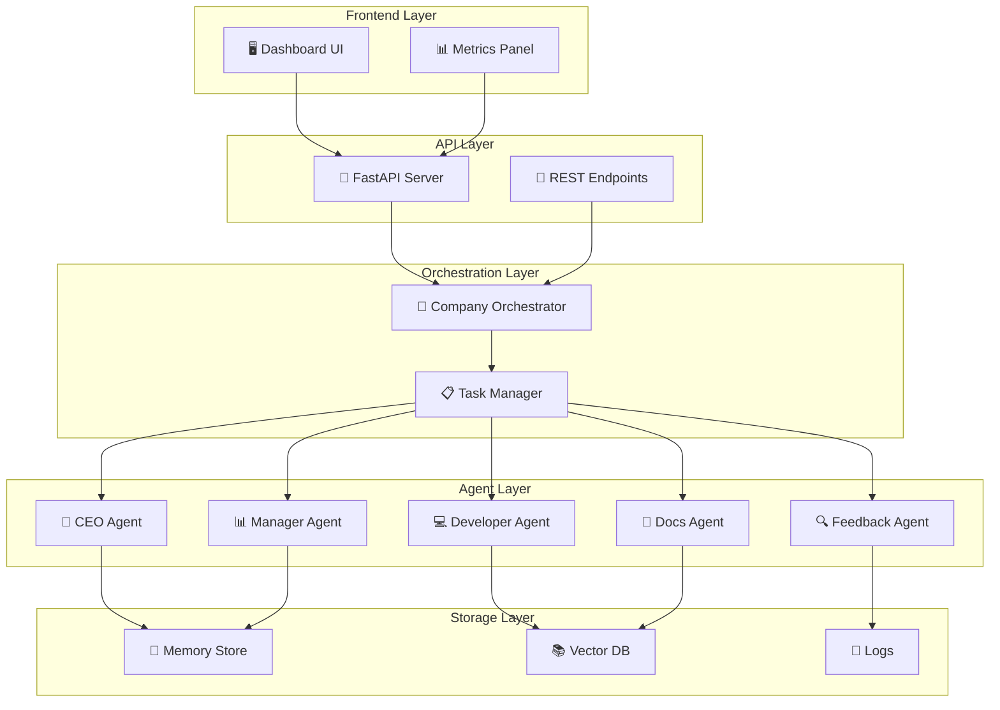

<div align="center">

# 🤖 Multi-Agent Virtual Company (MAVC)

### *Simulating Real-World Startup Operations with Autonomous AI Agents*

<p align="center">
  
</p>

<!-- Animated Badges -->
<p align="center">
  
  
  
  
</p>

<p align="center">
  
  
  
</p>

<!-- Animated Progress Bars -->
<p align="center">
  
  
  
  
</p>

---

### 🎯 *Autonomous agents working together like a real startup team*

</div>

## 📋 Table of Contents

- [🌟 Overview](#-overview)
- [✨ Key Features](#-key-features)
- [🏗️ System Architecture](#️-system-architecture)
- [🤖 Meet the Agents](#-meet-the-agents)
- [🚀 Quick Start](#-quick-start)
- [📊 Project Structure](#-project-structure)
- [💻 Tech Stack](#-tech-stack)
- [🎬 Demo & Screenshots](#-demo--screenshots)
- [📈 Progress Report](#-progress-report)
- [🔬 Research & Literature](#-research--literature)
- [🛣️ Roadmap](#️-roadmap)
- [🤝 Contributing](#-contributing)
- [📄 License](#-license)

---

## 🌟 Overview

<div align="center">

```ascii
╔═══════════════════════════════════════════════════════════════╗
║                                                               ║
║    🏢 Multi-Agent Virtual Company Simulation (MAVC)          ║
║                                                               ║
║    An AI-driven system where autonomous agents collaborate   ║
║    to simulate a real-world startup environment              ║
║                                                               ║
╚═══════════════════════════════════════════════════════════════╝
```

</div>

**MAVC** is a groundbreaking project that simulates a complete startup company using multiple specialized AI agents. Each agent represents a specific organizational role (CEO, Developer, Marketer, Designer) and operates autonomously while coordinating through a centralized orchestrator.

### 🎯 Problem Statement

Traditional systems struggle with:
- ❌ Complex multi-step workflows
- ❌ Manual task coordination
- ❌ Limited role-based specialization
- ❌ Lack of autonomous decision-making

### ✅ Our Solution

MAVC introduces:
- ✨ **Specialized AI Agents** - Each with distinct roles and capabilities
- 🔄 **Orchestrated Workflows** - Centralized coordination and task management
- 🧠 **Intelligent Decision-Making** - RAG-powered context-aware agents
- 📈 **Scalable Architecture** - Modular design for easy expansion

---

## ✨ Key Features

<table>
<tr>
<td width="50%">

### 🎭 Role-Based Agents
- **CEO Agent** - Strategic vision & planning
- **Developer Agent** - Code generation & implementation
- **Documentation Agent** - Technical writing
- **Feedback Agent** - QA & testing
- **Manager Agent** - Task delegation

</td>
<td width="50%">

### ⚡ Core Capabilities
- **Autonomous Execution** - Agents work independently
- **RAG Integration** - Grounded in factual knowledge
- **Version Control** - GitHub API integration
- **Memory System** - Persistent context tracking
- **Feedback Loops** - Iterative improvements

</td>
</tr>
</table>

<div align="center">


</div>

---

## 🏗️ System Architecture

<div align="center">



</div>

### 🔄 Workflow Pipeline

```
┌─────────────┐      ┌──────────────┐      ┌────────────────┐
│   User      │──────▶│  Orchestrator │──────▶│  Task Manager  │
│   Input     │      │   (CEO Agent) │      │                │
└─────────────┘      └──────────────┘      └────────────────┘
                              │                      │
                              ▼                      ▼
                     ┌─────────────────┐    ┌──────────────────┐
                     │  Manager Agent  │    │  Agent Pool      │
                     │  (Delegation)   │    │  • Developer     │
                     └─────────────────┘    │  • Docs          │
                              │             │  • Feedback      │
                              ▼             └──────────────────┘
                     ┌─────────────────┐
                     │  Memory & RAG   │
                     │  (Context)      │
                     └─────────────────┘
                              │
                              ▼
                     ┌─────────────────┐
                     │  GitHub API     │
                     │  (Commits)      │
                     └─────────────────┘
```

---

## 🤖 Meet the Agents

<table>
<tr>
<td width="33%" align="center">

### 👔 CEO Agent
**Role:** Strategic Leader
<br>


<br><br>
Defines company objectives, sets 6-month visions, and orchestrates high-level strategy.

</td>
<td width="33%" align="center">

### 📊 Manager Agent
**Role:** Task Coordinator
<br>


<br><br>
Breaks down objectives into actionable tasks and assigns them to specialized agents.

</td>
<td width="33%" align="center">

### 💻 Developer Agent
**Role:** Code Engineer
<br>


<br><br>
Generates, tests, and commits code to GitHub repositories.

</td>
</tr>
<tr>
<td width="33%" align="center">

### 📝 Documentation Agent
**Role:** Technical Writer
<br>


<br><br>
Creates README files, API docs, and code comments.

</td>
<td width="33%" align="center">

### 🔍 Feedback Agent
**Role:** Quality Assurance
<br>


<br><br>
Reviews outputs, runs tests, and provides improvement suggestions.

</td>
<td width="33%" align="center">

### 🎨 Designer Agent
**Role:** UI/UX Specialist
<br>


<br><br>
*Coming Soon* - Creates mockups and design systems.

</td>
</tr>
</table>

---

## 🚀 Quick Start

### Prerequisites

<div align="center">


</div>

### 📦 Installation

```bash
# Clone the repository
git clone https://github.com/yourusername/MAVC.git
cd MAVC

# Create virtual environment
python -m venv venv
source venv/bin/activate  # On Windows: venv\Scripts\activate

# Install dependencies
cd backend
pip install -r requirements.txt

# Install Ollama (if not already installed)
# Visit: https://ollama.ai/download
```

### ⚙️ Configuration

```bash
# Copy environment template
cp .env.example .env

# Edit configuration
nano .env
```

```env
# .env file
OLLAMA_HOST=http://localhost:11434
OLLAMA_MODEL=llama2
GITHUB_TOKEN=your_github_token_here
VECTOR_DB_PATH=./data/vectordb
LOG_LEVEL=INFO
```

### 🎯 Running the System

```bash
# Start the backend
cd backend
python main.py

# In a new terminal, start the frontend (when ready)
cd frontend
npm install
npm run dev
```

### 🧪 Quick Test

```bash
# Test the system
python scripts/run_simulation.sh --goal "Build a simple calculator app"
```

---

## 📊 Project Structure

```
MAVC/
│
├── 📄 README.md                    # This file
├── 🐳 docker-compose.yml           # Container orchestration
├── 📋 LICENSE
│
├── 📚 docs/                        # Documentation hub
│   ├── architecture/
│   │   ├── system_architecture.png
│   │   └── agent_flow_diagram.png
│   ├── reports/
│   │   └── project_report.pdf
│   └── screenshots/
│
├── ⚙️ backend/                     # Core system
│   ├── main.py                     # FastAPI entry
│   ├── config.py                   # Settings
│   │
│   ├── api/                        # REST endpoints
│   │   ├── routes.py
│   │   └── schemas.py
│   │
│   ├── orchestrator/               # Brain of the system
│   │   ├── orchestrator.py
│   │   └── task_manager.py
│   │
│   ├── agents/                     # AI agent implementations
│   │   ├── base_agent.py
│   │   ├── ceo_agent.py
│   │   ├── developer_agent.py
│   │   ├── documentation_agent.py
│   │   └── feedback_agent.py
│   │
│   ├── llm/                        # LLM integration
│   │   └── ollama_client.py
│   │
│   ├── memory/                     # State management
│   │   ├── state_store.py
│   │   └── artifacts_store.py
│   │
│   └── requirements.txt
│
├── 🎨 frontend/                    # Dashboard (React/Next.js)
│   ├── package.json
│   ├── src/
│   │   ├── app/
│   │   ├── components/
│   │   └── services/
│
└── 🔧 scripts/
    ├── start_backend.sh
    └── run_simulation.sh
```

---

## 💻 Tech Stack

<div align="center">

### Backend Technologies


### AI & ML


### Frontend (Planned)


### Tools & DevOps


</div>

---

## 🎬 Demo & Screenshots

<div align="center">

### 📺 System in Action

```
┌────────────────────────────────────────────────────┐
│  🎯 MAVC Simulation Dashboard                     │
├────────────────────────────────────────────────────┤
│                                                    │
│  📊 Active Agents: 5/5                            │
│  ⚡ Tasks Completed: 127                          │
│  ⏱️  Avg Response Time: 2.3s                       │
│                                                    │
│  👔 CEO Agent:       [████████████] Planning      │
│  📊 Manager Agent:   [████████████] Delegating    │
│  💻 Developer Agent: [████████░░░░] Coding        │
│  📝 Docs Agent:      [████████████] Writing       │
│  🔍 Feedback Agent:  [████████████] Reviewing     │
│                                                    │
└────────────────────────────────────────────────────┘
```

### 📸 Sample Outputs

</div>

#### Developer Agent Output
```python
# File: calculator.py
# Generated by Developer Agent

def add(a: float, b: float) -> float:
    """Add two numbers and return the sum."""
    return a + b

def subtract(a: float, b: float) -> float:
    """Subtract b from a and return the result."""
    return a - b

def multiply(a: float, b: float) -> float:
    """Multiply two numbers and return the product."""
    return a * b
```

#### Documentation Agent Output
```markdown
# Calculator Module

## Overview
A simple calculator library providing basic arithmetic operations.

## Functions

### `add(a, b)`
Returns the sum of two numbers.

**Example:**
```python
result = add(5, 3)  # Returns 8
```

### `subtract(a, b)`
Returns the difference when b is subtracted from a.
```

#### Feedback Agent Output
```
✅ Code Review Results:
  • Syntax: PASSED
  • Type Hints: PASSED
  • Documentation: PASSED
  • Tests: 12/12 PASSED
  
⚠️  Suggestions:
  • Consider adding input validation
  • Add support for complex numbers
  
🎯 Overall Grade: A-
```

---

## 📈 Progress Report

<div align="center">

### 🏆 Development Milestones

| Milestone | Status | Completion |
|-----------|--------|------------|
| 📋 Project Planning | ✅ Complete | 100% |
| 🏗️ Architecture Design | ✅ Complete | 100% |
| ⚙️ Backend Setup | ✅ Complete | 100% |
| 🤖 Core Agents | 🔄 In Progress | 75% |
| 🧠 Memory System | 🔄 In Progress | 60% |
| 🎨 Frontend Dashboard | ⏳ Pending | 30% |
| 🐳 Docker Setup | ⏳ Pending | 20% |
| 📊 Analytics | ⏳ Planned | 0% |

</div>

### ✅ Completed Tasks
- [x] Project ideation and problem definition
- [x] System architecture design
- [x] FastAPI backend implementation
- [x] Orchestrator logic
- [x] Base agent class framework
- [x] Task manager integration
- [x] GitHub API integration
- [x] Basic RAG implementation

### 🔄 In Progress
- [ ] Advanced agent specialization
- [ ] Persistent memory with vector database
- [ ] Frontend dashboard development
- [ ] Task dependency resolution
- [ ] Agent parallelization

### ⏳ Upcoming
- [ ] Real-time collaboration UI
- [ ] Database integration (PostgreSQL)
- [ ] Advanced testing framework
- [ ] Deployment automation
- [ ] Performance optimization
- [ ] Evaluation metrics

---

## 🔬 Research & Literature

<div align="center">

### 📚 Key Research Areas

</div>

#### Multi-Agent Systems (MAS)
- **Specialization**: Each agent masters a specific domain
- **Scalability**: Easy to add new agents for new capabilities
- **Fault Tolerance**: System continues if one agent fails

#### Role-Based Design
- Inspired by production AI systems using specialized personas
- "Minimum access" principle for tool assignment
- Clear role specifications as contracts

#### Autonomous Agents
- Influenced by AutoGPT, BabyAGI architectures
- Task decomposition and iterative execution
- Long-term memory via vector stores

#### Retrieval-Augmented Generation (RAG)
- Grounds agent outputs in factual data
- Prevents hallucinations
- Enables knowledge base integration

### 📖 References

<details>
<summary>Click to expand full reference list</summary>

1. Microsoft Multi-Agent Reference Architecture
2. Azure AI Agent Orchestration Patterns
3. Google Cloud: What is a Multi-Agent System?
4. Anthropic: Multi-Agent Research System
5. AutoGPT & BabyAGI Documentation
6. LangChain & LangGraph Frameworks
7. Pinecone: RAG Best Practices
8. Ollama Local LLM Platform

</details>

---

## 🛣️ Roadmap

<div align="center">

### 🗺️ Future Development Plans

</div>

```
2026 Q1
├── ✅ Core system architecture
├── ✅ Basic agent implementation
└── 🔄 Memory system integration

2026 Q2
├── ⏳ Frontend dashboard
├── ⏳ Real-time agent monitoring
├── ⏳ Advanced RAG implementation
└── ⏳ Parallel agent execution

2026 Q3
├── 📅 Database integration
├── 📅 User authentication
├── 📅 Multi-tenancy support
└── 📅 Cloud deployment

2026 Q4
├── 📅 Reinforcement learning agents
├── 📅 Advanced analytics
├── 📅 API marketplace
└── 📅 Enterprise features


### 🎯 Vision

> "To create the most advanced multi-agent simulation platform that democratizes AI-powered company operations"

---

## 🤝 Contributing

<div align="center">

We welcome contributions from the community! 🎉


</div>

### How to Contribute

1. 🍴 Fork the repository
2. 🔨 Create a feature branch (`git checkout -b feature/AmazingFeature`)
3. 💾 Commit your changes (`git commit -m 'Add some AmazingFeature'`)
4. 📤 Push to the branch (`git push origin feature/AmazingFeature`)
5. 🔃 Open a Pull Request

### 💡 Ideas for Contribution

- 🐛 Report bugs and issues
- ✨ Suggest new features
- 📝 Improve documentation
- 🧪 Add tests and examples
- 🎨 Enhance UI/UX
- 🌍 Add internationalization

### 📜 Code of Conduct

Please read our [Code of Conduct](CODE_OF_CONDUCT.md) before contributing.

---

## 📞 Contact & Support

<div align="center">

### 💬 Get in Touch

[](https://github.com/yourusername/MAVC/issues)
[](mailto:your.email@example.com)
[](https://linkedin.com/in/yourprofile)
[](https://twitter.com/yourhandle)

</div>

---

## ⭐ Show Your Support

<div align="center">

If you find this project helpful, please consider giving it a ⭐!

[](https://github.com/yourusername/MAVC)
[](https://github.com/yourusername/MAVC/fork)

### Share the Project

[](https://twitter.com/intent/tweet?text=Check%20out%20MAVC%20-%20Multi-Agent%20Virtual%20Company!&url=https://github.com/yourusername/MAVC)
[](https://www.linkedin.com/sharing/share-offsite/?url=https://github.com/yourusername/MAVC)

</div>

---

## 📄 License

<div align="center">

This project is licensed under the MIT License - see the [LICENSE](LICENSE) file for details.


</div>

---

## 🙏 Acknowledgments

<div align="center">

Special thanks to:

- 🤖 **Anthropic** - For Claude and multi-agent research insights
- 🦙 **Ollama** - For local LLM infrastructure
- 🔗 **LangChain** - For agent framework inspiration
- 🌲 **Pinecone** - For vector database solutions
- 🚀 **FastAPI** - For the excellent backend framework
- 💙 **Open Source Community** - For continuous inspiration

</div>

---

<div align="center">

### 🌟 Built with ❤️ by the MAVC Team

<p align="center">
  
</p>


**[⬆ back to top](#-multi-agent-virtual-company-mavc)**

</div>

---

<div align="center">

### 📊 Repository Stats


</div>
