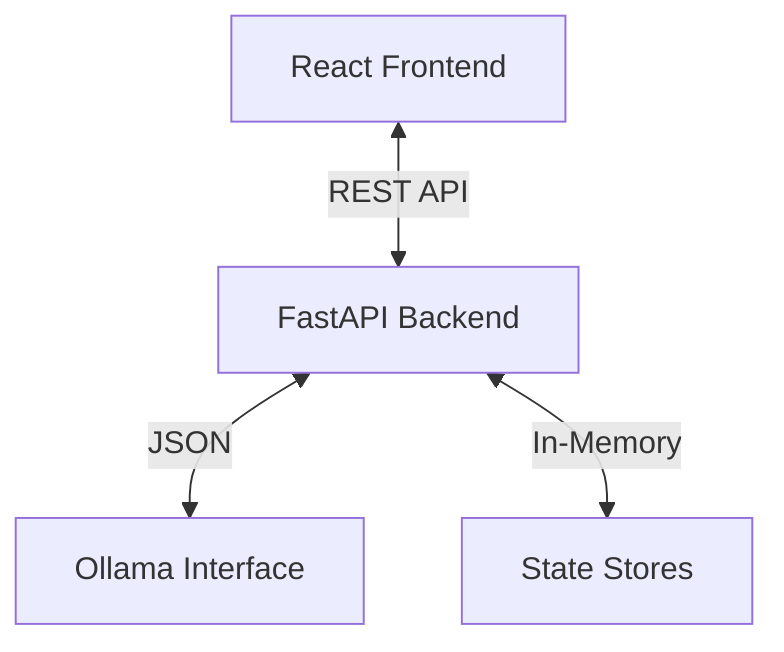

# System Architecture

## Overview

The Virtual Company Simulator uses a hybrid **Client-Server-LLM** architecture. This ensures a responsive UI (Frontend) while maintaining complex logic and state consistency (Backend) and leveraging probabilistic intelligence (LLM).

## Backend Components (Python/FastAPI)

### 1. API Layer (`backend/api/`)
-   **Routes**: Exposes REST endpoints (e.g., `/simulation/tick`).
-   **Schemas**: Pydantic models (e.g., `SimulationState`, `AgentAction`) ensuring strict typing between frontend and backend.

### 2. Service Layer (`backend/services/`)
-   **SimulationService**: The entry point for simulation ticks. It aggregates state updates, calls the orchestrator, and handles random event generation.

### 3. Orchestrator (`backend/orchestrator/`)
-   **Orchestrator Class**: Manages the mapping between Agent IDs and Agent Class Instances. It iterates through all active agents during a tick, collecting their actions.

### 4. Agents (`backend/agents/`)
-   **BaseAgent**: Abstract base class defining the `process(state)` interface and helper methods (`_generate_response` via LLM).
-   **Specific Agents**: (e.g., `CEOAgent`, `DeveloperAgent`) Implement role-specific logic and prompts.

### 5. Memory (`backend/memory/`)
-   **StateStore**: Singleton holding the current simulation snapshot.
-   **LogsStore**: Append-only log of all system events.
-   **ArtifactsStore**: Storage for documents/code generated by agents.

### 6. LLM Client (`backend/llm/`)
-   **OllamaClient**: A wrapper around the local Ollama API (`http://localhost:11434`). Handles prompting and error recovery.

## Frontend Components (React/TS)

### 1. State Management
-   **useSimulation**: A massive custom hook acting as the central store for the frontend. It manages the dual-state (local optimistic updates + backend synchronization).

### 2. UI Library
-   **Shadcn/UI**: Provides accessible, consistent components.
-   **TailwindCSS**: Handles styling with utility classes.

## Data Flow (The "Tick")

1.  **Trigger**: Frontend `useTime` hook fires a tick interval.
2.  **Request**: Frontend sends current `SimulationState` to `POST /simulation/tick`.
3.  **Process**:
    *   Backend updates `StateStore`.
    *   Orchestrator asks each Agent to `process()`.
    *   Agents prompt Ollama: "You are a CEO... Project is X... What do you do?".
    *   Agents return generic `AgentAction` objects (e.g., `type: 'message'`).
4.  **Response**: Backend returns list of `AgentAction`s and `metrics_update`.
5.  **Render**: Frontend updates React state, adding messages to Chat, creating Tasks on the Board, etc.
